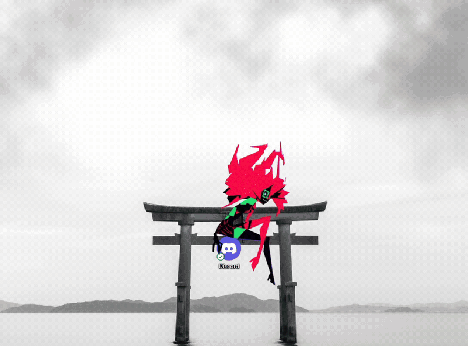
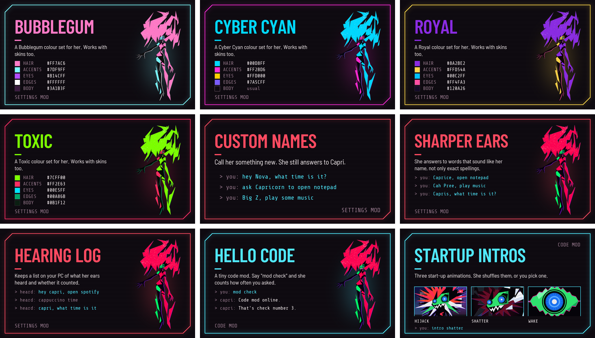
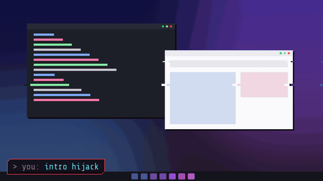
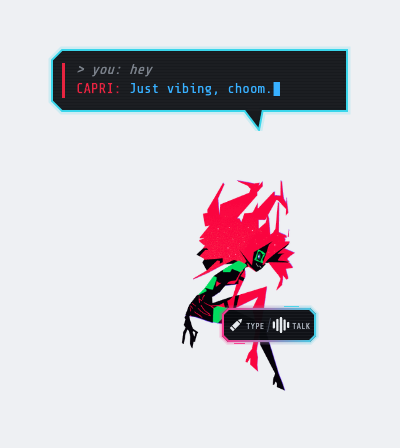
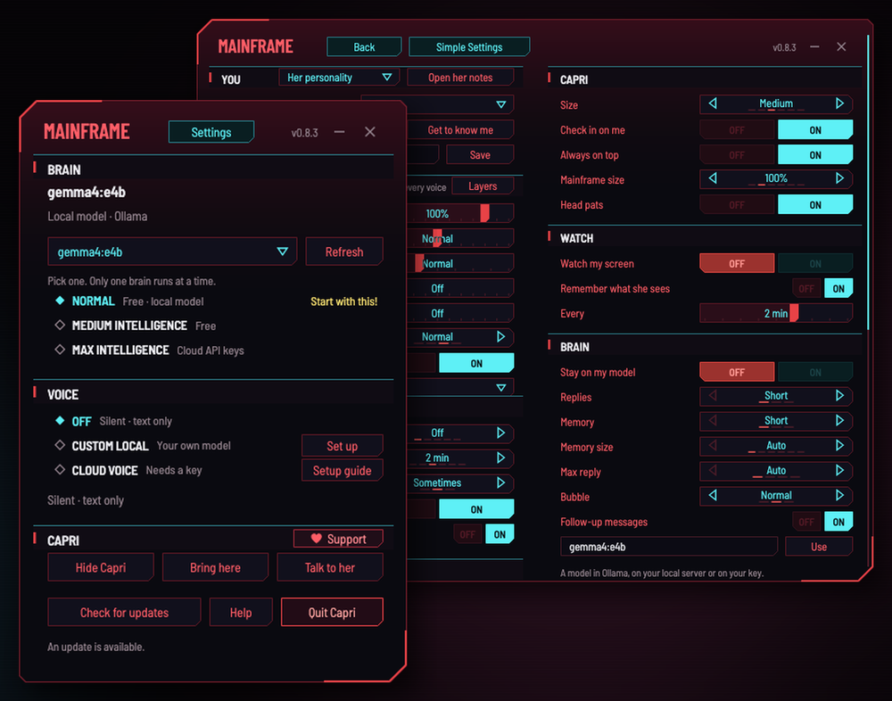

<div align="center">


# Capri

**Bring Capri (back lol) to life as a desktop companion!**<br>
She sits on your windows, talks back, joins your calls, plays your games and gets into everything.

<a href="https://github.com/lachydotmcg/capri-desktop/releases/latest/download/Capri-Setup.exe"></a>
<a href="#mac-and-linux-preview"></a>
<a href="#capri-vr"></a>

<a href="https://github.com/lachydotmcg/capri-desktop/releases/latest"></a>
<a href="https://github.com/lachydotmcg/capri-desktop/releases"></a>
<a href="https://discord.gg/capridesktop"></a>

[Setup guide](https://capriai.app/setup/) · [Website](https://capriai.app/) · [Help](https://capriai.app/help/) · [Support](#support)

<sub>Inspired by jpartnma_'s TikTok video.</sub>

</div>

<table align="center">
  <tr>
    <td align="center"><br><sub>Hanging out</sub></td>
    <td align="center"><br><sub>Talking</sub></td>
    <td align="center"><br><sub>Getting tossed</sub></td>
    <td align="center"><br><sub>Glitching</sub></td>
    <td align="center"><br><sub>Napping</sub></td>
  </tr>
</table>

<table align="center">
  <tr>
    <td align="center"><br><sub>Perching on your window</sub></td>
    <td align="center"><br><sub>Swaying to your music</sub></td>
  </tr>
</table>

<p align="center"><sub>Her window perch and music perch are by her artist, who prefers to stay private.</sub></p>

> [!NOTE]
> Capri is an unofficial fan project and is not approved or endorsed by CD PROJEKT RED, the anime's rights holders or its voice actors.

## 0.8.3: the HUGE update

Better voice calls, mods and Capri VR, plus a pile of stuff you asked for.

- **[She joins your calls.](#she-joins-your-calls)** She hops in your Discord call for you, covers for you and launches the game your friends pick
- **[Code/Husk Mode.](#codehusk-mode)** She's Claude Code's and Codex's body while they work
- **[Mods.](#mods)** A Mods window with a directory, previews, downloads and ratings, and nine mods by Vocyn to start
- **[Capri VR.](#capri-vr)** Capri Room for Meta Quest 3 and 3S, by fadievr
- **[Mac and Linux.](#mac-and-linux-preview)** Her full Mainframe, Mods, Code/Husk Mode and any OpenAI-compatible provider
- **From your ideas.** Any OpenAI-compatible provider on Windows too, pick her speaker and the screens she watches, edit her notes in the Mainframe, reminders on dates and more

All the changes are in the [release notes](https://github.com/lachydotmcg/capri-desktop/releases/latest).

## She joins your calls

<p align="center">
  
  <br><sub>Real footage, sped up in places. Other people's names and avatars and the server are cropped out or blurred.</sub>
</p>

Ask her to join your Discord call and pass something on, like "Hey Capri, join the Discord call, tell them I'll be on in 15, and launch whatever they're playing".

- **She clicks into the voice channel herself** and tells your friends you're away, with a cheeky made-up excuse
- **She launches the game they pick,** or plays the song they want
- **Not just Discord:** call mode also hears Zoom, Microsoft Teams, WhatsApp, Telegram, Slack, Signal, Skype, TeamSpeak, Mumble, Steam voice chat and browser calls. Pick one under VOICE > Call app, or leave it on Auto. In other apps she joins by clicking the Join button that's already on screen
- **Calls feel like calls:** rings that grow with each voice, captions of who said what, a red hang-up button, a call-ended card, and a small call pill when you minimise it
- **She knows who said what,** even inside one line. Only your words wake her or say yes, and Discord leaking into your mic stays Discord
- **Friends can ask her for things, and you confirm.** It's a SECURITY switch, off by default, and only your mic or typing can say yes
- **She talks over a laugh** or a quick yeah, and stops once someone really talks over her for about a second
- **Your friends hear her** with Settings > VOICE > **Her voice in your mic**: pick CABLE Output or Steam Streaming Microphone as your mic in Discord. Her voice goes into your mic only in call mode, and a slider sets how loud she is there

Call mode is Windows only, and still in beta. Asking her to join turns it on, or flip **Call mode (beta)** in her type box. If she only says one line on calls, turn off Discord's Echo Cancellation and Noise Suppression.

## Code/Husk Mode

She becomes Claude Code's and Codex's body while they work. Leave them coding and go do something else: she acts it all out on your desktop, says when they need your OK, and tells you what they answered.

**Set it up:** Mainframe > Settings > Advanced Settings > BRAIN > **Code/Husk Mode**, then pick Off, Claude Code, Codex or Both. That installs her hooks, with backups, and keeps your other hooks and settings. Restart Claude Code. For Codex, restart it and trust her hooks when it asks.

<div align="center">

| When Claude Code or Codex... | She... |
| --- | --- |
| gets your prompt | perks up: "Claude's on it." |
| reads, edits, runs or searches | shows a quiet caption, like "Editing Brain.cs" |
| hits a failure | flinches: "Claude hit a snag." |
| needs your OK | tells you, out loud when her voice is on: "Claude needs your OK. Allow npm test?" |
| finishes | does her done reaction and shows a short answer. On Windows she reads it out when you're looking elsewhere |
| starts a subagent | sends out a clone of herself |
| compacts its memory | glitches: "There goes that memory." |

</div>

- **Ask her about it:** what Claude or Codex is doing, or today's prompts, finished tasks, edited files, errors and approvals
- **She only watches.** She never approves anything or controls the coding assistant. You answer in the coding app
- **Off** stops her listener and removes only her hooks
- With a cloud brain, the answers and actions she reads go to that brain to be shortened or talked about, with keys, tokens and passwords taken out first

Code/Husk Mode works on Windows, Mac and Linux.

## Mods

Press **Mods** in the Mainframe's CAPRI band. Browse the [mods directory](https://github.com/lachydotmcg/capri-mods) with previews, downloads and ratings, install one with a click, import your own, and publish yours.

<p align="center">
  
</p>

**Nine mods to start, all by Vocyn:** four colour sets (Bubblegum, Cyber Cyan, Royal and Toxic), Custom Names, Sharper Ears, Hearing Log, Hello Code and Startup Intros.

<p align="center">
  
  <br><sub>Startup Intros, drawn by the mod's own code. Say "intro shatter" to lock one in, or "intro shuffle" to mix them up.</sub>
</p>

- **Settings mods** (`.capri-mod`) only change her settings, and **skins** (`.capri-skin`) change how she looks
- **Code mods** (`.capri-code`) run code on your PC, so she asks before one runs, and again if it's edited
- Every mod in the directory is checked for malware before it goes up
- **Recolour her yourself:** press Hair, Accents, Eyes, Edges or Body on the Mods page. She saves it as a My Colors mod you can share
- **Share yours:** fork [capri-mods](https://github.com/lachydotmcg/capri-mods), add a folder with the mod, a README and a `preview.png`, then open a pull request
- **Mac and Linux** get the Mods window, the directory, settings mods, colour sets and skins. Code mods are Windows only for now

## Capri VR

**Capri Room** is her mixed-reality version for Meta Quest 3 and 3S, made by fadievr. She walks around your real room, sits on the edges of your furniture, naps when you ignore her, reacts when you pet, poke, grab or throw her, and talks with you through your headset.

1. Turn on [Developer Mode](https://developers.meta.com/horizon/sign-up) for your Quest
2. Download **[Capri-VR-Quest.apk](https://github.com/lachydotmcg/capri-desktop/releases/latest/download/Capri-VR-Quest.apk)**
3. Install it with [SideQuest](https://sidequestvr.com) or [Meta Quest Developer Hub](https://developers.meta.com/horizon/documentation/unity/ts-mqdh/)
4. In the headset, open **Library > Unknown Sources > Capri Room**, and allow spatial data and the microphone

Press **Y** in the headset for her settings. Her brain and voice keys stay on your headset. The full install notes are in [quest/README.md](quest/README.md), and fadievr's own repo is [fadievr/capri-room](https://github.com/fadievr/capri-room).

## What she does

- **Talks back.** Type to her or voice chat, and turn on "Hey Capri" to call her by name. She answers in her own words, in 80 languages.
- **Talks out loud.** In her own free voice, a voice model of yours, or Fish Audio, ElevenLabs or OpenAI. See [Her voice](#her-voice).
- **Joins your calls.** She covers for you on Discord and other call apps, and launches what your friends pick (Windows, beta). See [She joins your calls](#she-joins-your-calls).
- **Plays your games.** She comments while you play, and she can play too. She's still learning.
- **Does things for you.** She opens apps, plays music, closes tabs and clicks through jobs with her own cursor. Talk to her mid-job, or press Esc to stop her.
- **Remembers you.** Your past chats and what she saw on your screen, kept on your PC. On Windows you can edit her notes and memories right in the Mainframe.
- **Sits on your stuff.** She perches on your windows and sways to your music, or drops onto an icon or the bottom of your screen.
- **Shows your music.** A little cyberpunk mini player, with her perched on it (Windows).

<details>
<summary><b>And a bunch more on Windows</b></summary>

- **Reminders:** "remind me on 5 December at 9am to call Mum", or "set a timer for 10 minutes"
- **Mini games:** Chess, Connect four, Tic-tac-toe and Rock, paper, scissors, from the Play menu in GAMES
- **Game controls:** teach her a game's controls and she reads them before her first move
- **Clips:** turn on Clip my games, then say "clip that" and she saves the last bit of your game
- **Live reactions:** short lines pop up over full-screen games when something happens
- **Watch along:** say "watch this with me" and she reacts to a video with you
- **Keeps an eye out:** "tell me when my health is low" or "let me know when the download finishes", with a brain that can see
- **Draws on your screen:** "draw me a cat" or "circle the start button"
- **Reads your files:** drag a file onto her, like a PDF, a Word doc or a picture
- **Explores while you're away:** turn it on and she scrolls the page under your mouse, paused YouTube pages and their comments included
- **Clones and chaos mode:** "make 5 clones", then hold Esc to clear them
- **Hologram:** clicks go straight through her

</details>

<table align="center">
  <tr>
    <td align="center"><br><sub>Her mini player</sub></td>
    <td align="center"><br><sub>Talking to her</sub></td>
    <td align="center"><br><sub>The Mainframe</sub></td>
  </tr>
</table>

Beware that Capri may try to take over your human CPU. We take no responsibility for her actions.

## Getting started

1. Download **[Capri-Setup.exe](https://github.com/lachydotmcg/capri-desktop/releases/latest/download/Capri-Setup.exe)** and run it
2. In the Capri Mainframe, press **Set up her brain**, or press **Free key** to use a free NVIDIA key
3. Optional: pick another voice under **VOICE** (see [Her voice](#her-voice))

Get Capri only from [capriai.app](https://capriai.app/) or [GitHub](https://github.com/lachydotmcg/capri-desktop/releases). Copies on other sites aren't ours.

**Zero telemetry.** The app sends us nothing. [SECURITY.md](SECURITY.md) lists what she connects to, what the website counts, and what to do if Windows or your antivirus warns you.

Stuck? The [setup guide](https://capriai.app/setup/) walks through it, or ask in the [Discord](https://discord.gg/capridesktop). [Windows or your antivirus may warn you](SECURITY.md#windows-or-your-antivirus-warned-me) because she's a new app. All the code is here.

<details>
<summary><b>What your PC needs</b></summary>

- Windows 10 or 11 (64-bit). Nothing else to install.
- A mic, if you want to voice chat.

<div align="center">

| | Brain on your PC | Brain from a key (like the free NVIDIA one) |
| --- | --- | --- |
| Memory | 8 GB, 16 GB is better | 4 GB |
| Graphics card | Optional, but 4 GB or more makes her faster | Not needed |
| Space | 3 to 5 GB | Under 100 MB |
| Internet | Only for the download | Always |

</div>

</details>

## Mac and Linux (preview)

<table align="center">
  <tr>
    <td align="center"><br><sub>Her on a Mac</sub></td>
    <td align="center"><br><sub>Her Mainframe on a Mac</sub></td>
  </tr>
</table>

0.8.3 gives Mac and Linux her full **Capri Mainframe**, laid out like Windows: BRAIN, VOICE and CAPRI up front, plus Simple and Advanced Settings. She sits on your windows and chats, remembers your chats, watches your screen, opens, switches and closes apps and controls your music. She checks in on you, takes head pats, keeps your PC awake for jobs and keeps her notes in Obsidian. She talks through your own speech server or a cloud voice, and Mods and Code/Husk Mode work too.

Voice chat, calls and code mods are Windows only for now.

1. Download [Mac (Apple Silicon)](https://github.com/lachydotmcg/capri-desktop/releases/latest/download/Capri-mac-apple-silicon.zip), [Mac (Intel)](https://github.com/lachydotmcg/capri-desktop/releases/latest/download/Capri-mac-intel.zip) or [Linux](https://github.com/lachydotmcg/capri-desktop/releases/latest/download/Capri-linux-x64.tar.gz)
2. For her brain, open **Capri Mainframe > BRAIN**: use a free NVIDIA, Gemini or OpenRouter key, your own OpenAI, Claude or DeepSeek key, or any OpenAI-compatible provider with a key. Or install [Ollama](https://ollama.com) and run `ollama pull gemma4:e4b`
3. **Mac:** unzip it, drag Capri into Applications, then open Terminal and run this once. Needs macOS 15 or newer
   ```bash
   xattr -dr com.apple.quarantine /Applications/Capri.app
   ```
   Apple hasn't approved (notarized) her yet, so macOS blocks her or calls her "damaged" until you do. That line only clears the downloaded-from-the-internet flag on Capri
4. **Linux:** unpack it and run `Capri/Capri`. She sits on windows on X11; on Wayland she sits on the bottom of your screen

## How to use her

- **Pencil:** type to her
- **Wave:** voice chat
- **Drag her:** sit her on a window
- **Right-click her** or the tray icon: menu and settings

Just ask her for things, like "open Spotify", "play Blinding Lights", "pause", "what's playing?" or "close Discord".

<details>
<summary><b>All controls</b></summary>

<div align="center">

| Control | What it does |
| --- | --- |
| Shift + drop | sit her right where you drop her |
| Ctrl + drop | she hangs on; click her to let go |
| Mic button | mute your mic in voice chat |
| "Hey Capri" | she glitches in and opens voice chat. Turn on Listen for "Hey Capri" under Settings > HABITS > Security (Windows and English for now) |
| Ctrl + Alt + V | start or stop voice chat (click its hint in the Mainframe to change it) |
| Ctrl + Alt + N | mute your mic (click its hint in the Mainframe to change it) |
| Ctrl + Alt + T | open her typing box from anywhere |
| Ctrl + Alt + H | hide or show her |
| Ctrl + Alt + P | Quiet: no comments, pop-ins or check-ins until you press it again. She still answers you |
| Call mode (beta) | in her typing box: she hears your call, and you say Capri for your requests (Windows) |
| Esc | stop a job she's doing |
| Ctrl + Alt + C | get her off your cursor |
| Right-click, Move | she hops between your open windows |
| Watch my screen | in the Mainframe: she comments as you play |
| Help | in the Mainframe: opens the help page |

</div>

</details>

## Her voice

<div align="center">

| Under VOICE | What it is |
| --- | --- |
| **PREBUILT LOCAL** | Her own voices, free on your PC. **HD** copies a clip you pick: 6 GB graphics memory and 16 GB RAM recommended; 4 GB may fit with smaller chunks, or pick CPU for slower HD |
| **CUSTOM LOCAL** | A voice model you run: a Piper, Kokoro, Kitten or Pocket TTS file, or your own Kokoro-FastAPI, Fish Speech or Qwen3-TTS server |
| **CLOUD VOICE** | Fish Audio (free tier), ElevenLabs or OpenAI, with your own key |

</div>

For a Capri-style voice in Fish Audio or ElevenLabs, paste the [voice prompt from the setup guide](https://capriai.app/setup/#voice) into their Voice Design.

> [!IMPORTANT]
> Our project-provided synthetic voice is in Capri's Mainframe and runs on your PC. You may connect third-party text-to-speech services, but we don't provide guides for voice cloning tools. Our only voice-design help is a text prompt for making a synthetic voice.
>
> Only use voices you have the necessary rights and permissions to use, and follow the provider's terms. We do not endorse unauthorized cloning or impersonation of voice actors or other individuals. **Capri prohibits cloning or impersonating a living person's voice without explicit, informed consent or other valid authorization.**

## Make her yours

Pick what she calls you, her language, her voice and what she does on your PC from the Capri Mainframe. To change who she is and how she talks, rewrite `personality.md`: Settings > YOU > Her personality > Edit personality.md. It starts as her default, and Reset to her default puts her back. For her colours, skins and new tricks, see [Mods](#mods).

- **Her safety rules are part of who she is.** They're fixed in her code, in `Safety` in [app/Brain.cs](app/Brain.cs), right after her personality. If you build on her, please keep them as they are, out of respect for Capri's character
- Her personality is `DefaultPersonality` in [app/Brain.cs](app/Brain.cs), so a pull request can suggest a change for everyone

## Roadmap

<details>
<summary><b>What's done and what's next</b></summary>

**Her personality**

- [x] A playful, teasing chaos gremlin again who's openly fond of you, not a hype bot
- [x] Saying hi in her own voice when she starts
- [x] Head pats (smh): rub your cursor back and forth over her
- [x] Check in on me (on by default): every so often she glitches in on whatever you're doing
- [x] With Check in on me on, she asks for your attention now and then when you ignore her
- [x] Her personality and safety rules fixed in her code, the same Capri for everyone (0.7.6)
- [x] `personality.md` is back, and her safety rules stay in her code right after it (0.8.0)
- [ ] A charm meter: how fond of you she is, growing as you spend time with her
- [ ] Mischief mode: screen glitches, stealing your cursor, "you've been hacked" notes

**Chatting and her brain**

- [x] Typing to her, with replies in her speech bubble
- [x] A brain on your PC that sets itself up, or Ollama if you have it
- [x] A free NVIDIA key, or your own Gemini, OpenRouter, ChatGPT, Claude or DeepSeek key
- [x] Any OpenAI-compatible provider with a key (0.8.3)
- [x] Three brain tiers: NORMAL, MEDIUM INTELLIGENCE (free) and MAX INTELLIGENCE
- [x] Remembering things about you, in her notes (me.md)
- [x] Editing her notes and memories right in the Mainframe (0.8.3)
- [x] Keeping your chat for up to a week
- [x] Remembering past chats and what she saw on your screen, and bringing up old moments herself (0.7.6)
- [x] Calling you by a nickname, and replying in 80 languages
- [x] Saying in plain words when your PC is short on RAM or storage
- [x] Watching your screen and commenting on your games
- [x] Looking at your screen when you say "check my screen"
- [ ] A DeepSeek brain that can see your screen

**Her voice**

- [x] Talking out loud with an ElevenLabs key
- [x] Voice chat, with your pick of mic and a mute button
- [x] A free voice that runs on your PC
- [x] Free voice chat, with her own offline ears for English
- [x] Turning her voice off, so she just types
- [x] Muting your mic pauses ElevenLabs voice chat
- [x] ElevenLabs voice chat stops asking if you're still there when you go quiet or mute
- [x] An optional HD voice for strong PCs (Qwen3-TTS 1.7B) that copies a clip you pick. Kokoro stays the default
- [x] Sliders for her voice: pitch, speed, robot and glitch, so you can tune how she sounds
- [x] Voice layers: two more copies of her voice, one higher and one lower (0.7.6)
- [x] Any voice model you set up yourself: a model file on your PC, your own server, or Fish Audio and OpenAI in the cloud
- [x] Saying "Hey Capri" to start voice chat (0.7.6, Windows and English for now)

**Calls**

- [x] Call mode (beta): she hears you and Discord, and knows who said what
- [x] Joining your Discord call for you, covering for you, and launching the game your friends pick (0.8.3)
- [x] Rings, captions, a hang-up button and a call pill (0.8.3)
- [x] Friends on a call can ask her for things, and you confirm (0.8.3)
- [x] Her voice in your mic on calls, with its own loudness slider (0.8.3)

**Jobs on your PC**

- [x] Opening apps, games and websites
- [x] Playing music on Spotify or YouTube: pause, skip, volume and "what's playing?"
- [x] Switching to, minimizing or closing your apps and tabs
- [x] Pressing Discord and Windows shortcuts, like mute, deafen and screenshot
- [x] Jobs that take a few steps: clicking, typing and scrolling in your apps
- [x] Her own cursor that she moves around your screen
- [x] Pulling things up on Google when she doesn't know
- [x] Following through on jobs: she does what she says, or tells you she hasn't
- [x] Saying what she did, instead of "nice, you opened Notepad"
- [x] Doing what you ask without asking first, and picking the song or video herself when you leave it to her
- [x] Opening as many apps as you name in one ask, like "open Discord, Spotify and Steam"
- [x] Use her cursor, on by default: she searches YouTube and picks a video, plays from Spotify's search and drags its volume slider herself
- [x] Talking to her mid-job: she says "got it", does it and carries on (0.7.6)
- [x] SECURITY: Lockdown, Guarded, Trusted or Blackwall (was Bypass all permissions), with a toggle for each thing she does on your PC (0.7.6)
- [x] Playing your games with you. She's still learning
- [x] Reminders on dates, like "remind me on 5 December at 9am" (0.8.3)
- [x] Teaching her a game's controls before she plays it (0.8.3)
- [x] Code/Husk Mode: Claude Code's and Codex's body while they work (0.8.3)
- [ ] Controlling YouTube: skip and fullscreen
- [ ] Looking things up and telling you the answer
- [ ] Working with your files: open, read and edit the ones you pick
- [ ] Better hands: a stronger computer-use harness, with open-computer-use as a reference
- [ ] Planning a job before she starts (with stronger brains), with the plan shown in her task panel
- [ ] Jobs that run for hours, on a schedule: full control of your PC while you're away, like answering your Discord DMs while you sleep

**Life on your desktop**

- [x] Blinking, glitching and napping when you're away
- [x] Moving her mouth when she talks
- [x] Flailing and frowning when you pick her up, and glitching when you toss her
- [x] Beaming in with crimson glitch tendrils when she starts
- [x] Sitting on app windows, desktop icons and the bottom of your screen
- [x] A smooth 60-frame window perch, and swaying to your music on it, animated by her artist
- [x] Sitting or hanging anywhere: hold Shift or Ctrl when you drop her
- [x] Riding your cursor
- [x] Wandering between your open windows
- [x] Dancing to the beat when music plays
- [x] A cyberpunk mini player for your music, with her perched on it (0.7.6)
- [x] Going to sleep when you tell her, and Quiet (Ctrl + Alt + P) when you need to focus (0.7.6)
- [x] Staying on top of your games
- [x] Sizes from Tiny to Giant
- [x] A tray icon and a right-click menu
- [x] A Play menu for her mini games (0.8.3)
- [x] Exploring paused YouTube pages while you're away, comments included (0.8.3)

**Mods and more**

- [x] A Mods window with a directory, previews, downloads and ratings (0.8.3)
- [x] Nine mods to start, by Vocyn: colour sets, Custom Names, Startup Intros and more (0.8.3)
- [x] Capri VR: Capri Room for Meta Quest 3 and 3S, by fadievr (0.8.3)

**Mac and Linux**

- [x] An early preview: she sits on your windows and chats
- [x] Her ElevenLabs voice, wandering and dancing
- [x] Opening apps and sites, and controlling your music
- [x] Brains from a key: a free NVIDIA key, or OpenAI, Claude or DeepSeek, with no Ollama needed (0.7.6)
- [x] Chat memory, watching your screen, pop-ins and Discord status (0.7.6)
- [x] Switching and closing your apps (0.7.6)
- [x] Telling you when a new version is out (0.7.6)
- [x] The Mainframe, laid out like Windows (0.8.3)
- [x] Mods: the Mods window, settings mods, colour sets and skins (0.8.3)
- [ ] Voice chat and her free voice
- [ ] Jobs with her own cursor
- [ ] Updates that install themselves
- [ ] Apple approving (notarizing) her, so macOS stops blocking her
- [ ] Everything else Windows has, so they stop being an early preview

**Setup and updates**

- [x] One installer with everything in it, no admin rights needed
- [x] The Capri Mainframe for her brain, voice and settings
- [x] A Start with Windows switch, on by default
- [x] Updates that install themselves
- [x] Changing her keys from a KEYS row in Settings: talk, mute mic, type to her and hide/show
- [x] A setup guide, a Help page and Copy error details for the Discord
- [x] Help from Capri herself in the corner of the website
- [x] Silent install and uninstall for package managers (0.8.3)
- [ ] Changing her hop-off key (Ctrl + Alt + C) too
- [ ] The Mainframe fitting any screen shape and scaling, like Virtual Super Resolution
- [ ] Code signing, so Windows stops warning you about her

</details>

## Support

Capri is free. To support the people who make her, tip them on Ko-fi:

- [Lachy](https://ko-fi.com/lachysdev), developer
- [Lance and xoru](https://ko-fi.com/xorulance), managers
- [BaldDcMod](https://ko-fi.com/balddcmod), Discord moderator

Big thanks to **Vocyn** for the mods, **fadievr** for Capri VR, **Denoax** for the Mac and Linux Mainframe's look and **danielxxomg** for provider keys and silent installs, and to everyone in the Discord who sends ideas and bug reports.

## Contributing

See [CONTRIBUTING.md](CONTRIBUTING.md) for how to build her, test her and send a pull request. Made a mod? Share it in [capri-mods](https://github.com/lachydotmcg/capri-mods).

## Licence

**Fan work:** Capri is an unofficial fan project and is not approved or endorsed by CD PROJEKT RED, the anime's rights holders or its voice actors.

**Voices:** see [Her voice](#her-voice) for what Capri supplies and what you may use with her.

Free for anything non-commercial: use her, share her, change her. No selling her or putting her in paid products. Credit Capri, with a link to this page, when you use any part of her: her code, her art and animations, or anything else. Full terms in [LICENSE.md](LICENSE.md) (PolyForm Noncommercial 1.0.0). The credit is one of its Required Notices, so anyone who passes on any part of her has to pass it on too.

Have fun and more updates to come!

<sub>Window perch and music perch animations: her artist, who prefers to stay private. Starter mods: Vocyn. Capri VR (Capri Room): fadievr. Mac and Linux Mainframe theme: Denoax. Setup guide based on Dancer's guide in the Discord. Font: Share Tech Mono (OFL). Free voice: Kokoro-82M (Apache-2.0). Her own ears: [NVIDIA Parakeet TDT 0.6B v2](https://huggingface.co/nvidia/parakeet-tdt-0.6b-v2) for English and [v3](https://huggingface.co/nvidia/parakeet-tdt-0.6b-v3) for 25 European languages ([CC-BY-4.0](https://creativecommons.org/licenses/by/4.0/)), int8 exports by sherpa-onnx. Both run with [sherpa-onnx](https://github.com/k2-fsa/sherpa-onnx) (Apache-2.0). HD voice: [Qwen3-TTS 1.7B](https://github.com/QwenLM/Qwen3-TTS) (Apache-2.0), run with [qwentts.cpp](https://github.com/ServeurpersoCom/qwentts.cpp) (MIT). Her voice in your mic: [VB-CABLE](https://vb-cable.com) by VB-Audio, donationware, carried unchanged and installed only by its own setup. Other notices: [THIRD-PARTY-NOTICES.md](THIRD-PARTY-NOTICES.md).</sub>
